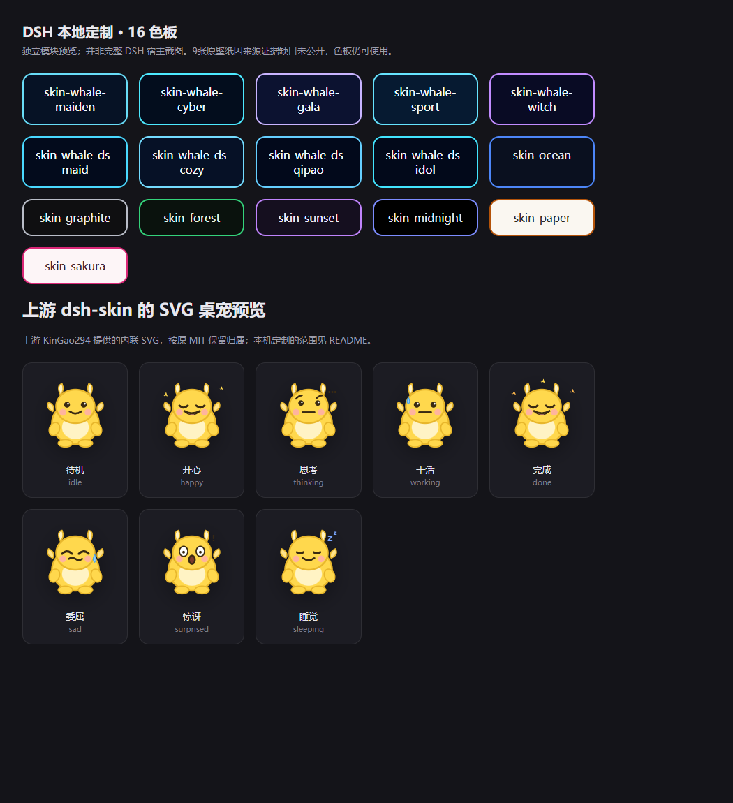

# DSH Skin · 本地鲸鱼色板定制

基于[KinGao294/dsh-skin](https://github.com/KinGao294/dsh-skin)的MIT衍生副本。保留上游7组色板、背景控制与SVG桌宠；本机追加9组鲸鱼主题色板及可选本地图片路由。**上游能力与美术归上游作者，本机不主张整个插件原创。**



[打开模块演示](https://yangwei251003.github.io/dsh-skin-local/) · [上游说明](UPSTREAM_README.md)

## 状态与图片缺口

原机9张背景PNG的精确生成/再分发依据未找到，因此不公开它们，原件继续保留。公开版默认只启用主题颜色，避免缺图请求；可选图片路由在文件缺失时明确404，不影响色板与上游SVG桌宠。原本机完整改动保存在`patches/local-whale-customization.patch`，可以审查功能差异，但不能从这个仓库恢复那9张原图。

演示页直接加载真实`lib/client.js`的16色板和8个上游SVG表情；宿主注入用最小shim，只展示模块输出，不声称DSH中的设置面板、存储和任务状态联动已整体验证。

## 最简运行

静态演示不需要账号：准备Python3，根目录执行`python -m http.server 8080`，浏览器打开`http://127.0.0.1:8080/preview.html`。线上Pages只发布演示HTML、客户端JS和许可证。

模块测试准备Node24：

```powershell
npm test
```

安装完整插件需先准备兼容DSH宿主及package.json列出的peer依赖，在自己的独立profile执行：

```powershell
dsh plugin --profile web add -w C:/path/to/dsh-skin-local
```

它会修改指定profile。本次没有安装到真实DSH、读取其配置或重启服务。可用自己的有权公开图片手动配置背景；原本地自动切图功能在公共副本关闭，不能宣称包含原9套完整美术主题。

## 源码与许可

- `lib/client.js`：上游完整可读JS与本机色板；本次公开副本关闭缺图自动设置。
- `lib/index.js`：9条固定本地图片路由；缺文件404、拒绝写请求，卸载时注销。
- `lib/types/`、`cordis.patch.yml`、`package.json`：原插件入口与宿主约束。
- `preview.html`：独立模块演示，不连接真实宿主。
- `tests/`：实际客户端模块导出与可选路由生命周期/方法检查。

基点`0a571a27adcc5f780b7b72386c9c294243eec5b3`。原10个跟踪文件均保全；保留[上游MIT](LICENSE)，本机定制/公开整理采用MIT，见[NOTICE](NOTICE)。不重新发布未知来源壁纸，不包含真实localStorage、DSH_HOME或私人配置。

2026-10-26：两个软件测试通过；独立Chrome桌面/手机模块验收详见迁移审计。真实DSH设置交互、桌宠任务联动与上游角色设计的额外权利范围未在迁移中重新验证；保留上游原版权声明，不冒充本机原创。后续计划补图源依据及独立宿主集成。本地不可据此删除。
